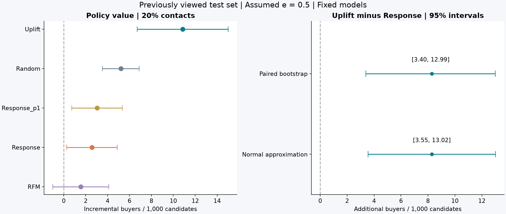

# RetailHero Uplift Modeling

基于 X5 RetailHero 数据的营销增量效果建模与触达策略评估。

在营销资源有限的情况下，客户选择需要考虑营销带来的增量购买，而不仅是客户本身的购买概率。本项目以 **20% 客户触达比例**为预设约束，结合历史交易特征、Uplift Modeling 与因果效应估计，对比不同选人策略的离线效果，形成从数据处理、模型训练到策略评价和结果展示的完整分析流程。

**技术栈：** Python · DuckDB SQL · Pandas · Scikit-learn · Matplotlib / Seaborn · Streamlit

## 分析结果

历史分析包含 **200,039 名有标签客户**，训练集、验证集与内部测试集分别为 120,023、40,008、40,008 人。以下结果来自历史固定划分的内部测试集，采用双重稳健估计（DR），触达比例为 20%。

指标为相对完全不触达时，**每千名候选客户的预计新增购买人数**；分母包括未触达客户。

<!-- RESULTS:START -->
| 策略 | 预计新增购买人数／千名候选客户 | 近似 95% CI |
|---|---:|---:|
| Random | 5.20 | [3.52, 6.89] |
| RFM | 1.55 | [-1.00, 4.10] |
| Response | 2.57 | [0.27, 4.88] |
| Response_p1 | 3.04 | [0.73, 5.35] |
| Uplift | 10.86 | [6.70, 15.02] |

Uplift 相对 Response 的离线估计差异为 **8.29 人／千名候选客户**，配对差异的近似 95% CI 为 **[3.55, 13.02]**。
<!-- RESULTS:END -->

策略定义：Random 为固定名额随机触达；RFM 按最近购买、购买频次与消费金额排序；Response 使用全训练样本拟合购买响应模型；Response_p1 仅使用触达组拟合响应模型；Uplift 按 T-learner 估计的增量效果排序。



结果来源：[策略评价表](reports/tables/test_policy_results.csv) · [配对差异表](reports/tables/test_policy_comparisons.csv)。图右侧另给出固定模型、固定选人结果下的配对 Bootstrap 区间。

上述结果为离线估计，不代表已实现的新增购买或利润。内部测试集曾用于查看结果，因此这些结果不构成新的独立验证；20% 为预设容量约束，不代表最优触达比例。

## 分析方法

| 环节 | 方法与内容 |
|---|---|
| 数据处理 | 使用 DuckDB SQL 将商品明细汇总至交易和客户层级，检查交易信息冲突与金额重复累计；处理异常年龄，排除无法确认在特征截止点前可用的日期字段。 |
| 模型训练 | 以 HistGradientBoosting 为基学习器构建 T-learner，估计个体增量效果；建立 RFM、Response 与 Response_p1 对照策略。 |
| 策略评价 | 使用 DR 与逆概率加权估计（IPW）评价策略价值，基于同一批客户估计策略间的配对差异与置信区间。 |
| 补充分析 | 比较 S/T/X-learner 与 Qini/AUUC 指标，检查处理概率敏感性、客户 Bootstrap 和重复划分稳定性，并开展成本与毛利假设下的预算情景分析。 |

训练集用于模型拟合和 RFM 阈值确定，验证集用于诊断与方案比较，内部测试集用于报告既有固定策略。Random 采用随机分配固定名额的期望权重。

详细说明：[研究设计](docs/research_design.md) · [稳健性分析摘要](reports/audit/summary.md) · [业务简报](docs/business_brief.md) · [线上实验方案](docs/online_experiment_plan.md)

## 运行方式

### 环境配置

已验证的本地运行环境为 Python 3.14.7。`requirements.txt` 固定主分析的直接依赖，`requirements-lock.txt` 保存完整环境快照。

```bash
python3.14 -m venv .venv
source .venv/bin/activate
python -m pip install -r requirements.txt
```

Windows 下使用 `.venv\Scripts\activate` 激活环境。已有环境中的主流程已通过运行验证；全新环境安装曾因软件源未提供指定版本的 DuckDB 而未完成，跨平台兼容性尚未验证，详见[环境验证记录](docs/public_repository_validation.md)。

### 合成数据演示

无需原始数据即可运行主流程：

```bash
python run_project.py --demo
```

默认生成 20,000 名合成客户，依次执行 01 → 02 → 03，结果保存在 `work/demo/reports/tables/`。合成数据用于演示流程，其效果由模拟机制设定，不作为真实业务结论。

### 真实数据分析

从 [X5 RetailHero 数据页面](https://ods.ai/competitions/x5-retailhero-uplift-modeling/data) 获取 `clients.csv.gz`、`uplift_train.csv.gz` 和 `purchases.csv.gz`，放入 `data/raw/` 后执行：

```bash
python run_project.py --new-split
```

程序以固定种子 42 按“处理 × 结果”分层生成约 60%／20%／20% 的训练、验证与测试划分，在 `work/new-split/` 中执行主流程，并记录输入哈希、划分信息与环境版本。

以上两种模式均使用独立目录。目录已存在时，可通过 `--output work/experiment-2` 指定新目录。**新划分用于复现分析方法，不保证得到上表中的历史数字。** 历史结果的精确恢复还需要未公开的原客户划分清单；完整参数与恢复方法见[运行与复现说明](docs/reproducibility.md)。

### 结果展示与检查

仓库包含可直接下载并在浏览器中打开的 [HTML 分析报告](reports/portfolio/项目展示报告.html)。可选 Streamlit 看板：

```bash
python -m pip install streamlit
python -m streamlit run dashboard/app.py
```

运行自动化检查，并核对 README 与结果表是否一致：

```bash
python -m unittest discover -s tests -v
python scripts/summarize_results.py --check
```

## 项目结构

| 文件或目录 | 内容 |
|---|---|
| [01_data_exploration.ipynb](01_data_exploration.ipynb) | 数据审计、交易聚合、客户特征与数据划分 |
| [02_modeling.ipynb](02_modeling.ipynb) | 响应模型、T-learner 与验证集诊断 |
| [03_policy_evaluation.ipynb](03_policy_evaluation.ipynb) | DR/IPW 策略评价、配对差异与预算曲线 |
| [04_portfolio_analysis.ipynb](04_portfolio_analysis.ipynb) | 客户画像、名单重合、成本情景与展示分析 |
| [05_robustness_and_business.ipynb](05_robustness_and_business.ipynb) | 处理概率敏感性、S-learner、Bootstrap 与划分稳定性 |
| [src/](src/) / [scripts/](scripts/) | 共用统计方法、运行脚本与报告生成 |
| [sql/](sql/) | 交易与客户特征聚合 SQL |
| [dashboard/](dashboard/) | Streamlit 交互看板 |
| [reports/](reports/) / [docs/](docs/) | 汇总结果、图表、研究设计与复现文档 |

## 研究局限

- **识别假设：** 原始实验的随机分配机制、触达定义与结果观察窗口尚未完全核实；处理概率 `e=0.5` 为分析假设。特征截止点 `2019-03-19 00:00:00` 由项目设定，不代表已确认的触达时间。
- **统计推断：** 主要区间条件于已训练模型，未完整包含模型重训、策略选择及多重比较的不确定性。部分 IPW 结果支持较弱，S-learner 在部分评价口径下优于 T-learner，现有结果不足以认定 T-learner 最优。
- **业务应用：** 样本主要覆盖近期活跃客户，缺少真实触达成本、贡献毛利与线上实验。预算分析基于假设情景，其结果仍需通过实际实验验证。

## 数据来源

项目由因果推断课程作业扩展，使用 [X5 RetailHero Uplift Modeling](https://ods.ai/competitions/x5-retailhero-uplift-modeling) 公开数据，评价指标与官方竞赛排名指标不同。数据与字段说明见[来源清单](docs/research_design.md#来源)。

仓库不包含原始数据、客户级中间结果、训练模型及本地运行目录。数据获取与使用须遵循原提供方条款，代码公开不代表原始数据的再分发授权。
